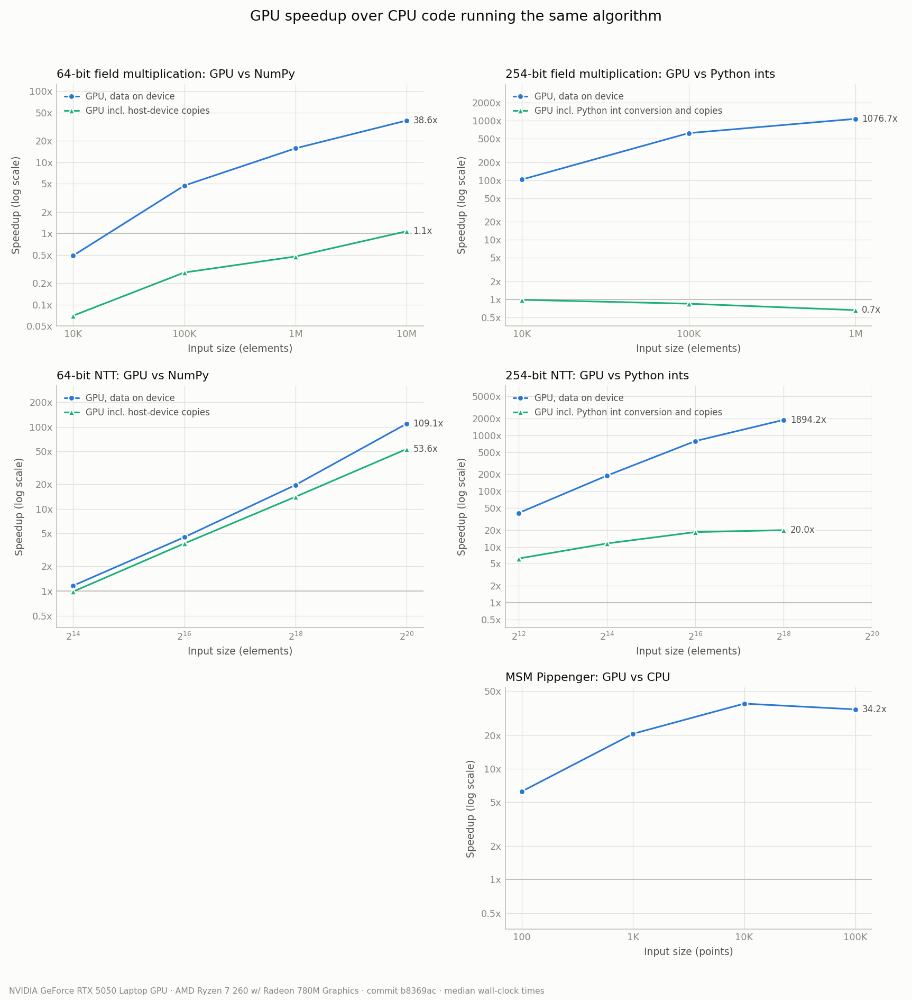

# ZK GPU Accelerator

[](https://github.com/erihhh6/zk-gpu-accelerator/actions/workflows/ci.yml)
[](https://www.python.org/downloads/)
[](LICENSE)


> The building blocks of a zero-knowledge prover (BN254 field and curve arithmetic, NTT, MSM) in Python, with CUDA kernels (via CuPy) for 64-bit and 254-bit modular arithmetic and the NTT, and benchmarks that measure what the GPU actually buys.

<picture>
  <source media="(prefers-color-scheme: dark)" srcset="results/speedup_curve_dark.png">
  
</picture>

---

## What this does

The two most expensive steps of a Groth16 or PLONK prover are the MSM and the NTT. This project implements both, plus the field arithmetic underneath them. It also measures each GPU path against CPU code that runs the same algorithm, and checks every result.

| Operation | ZK usage | What runs on the GPU | GPU speedup at the largest size measured against a CPU |
|---|---|---|---|
| **Field multiplication**, 64-bit | Building block of everything else | The whole operation (CuPy kernel), for moduli below 2⁶³ | **38.6x** with data on the GPU, **1.1x** including copies (10M elements) |
| **Field multiplication**, 254-bit | BN254's real fields: Fr for polynomials, Fq for curve points | The whole operation (CUDA Montgomery kernel) | **1,077x** with data on the GPU, but **0.66x** from and to Python ints (1M elements), against Python ints |
| **NTT**, 64-bit | Polynomial arithmetic (Groth16, PLONK) | Every butterfly stage, for moduli below 2⁶³ | **109x** with data on the GPU, **53.6x** including copies (2²⁰ elements) |
| **NTT**, 254-bit | The same, over BN254's real scalar field | Every butterfly stage, one CUDA kernel per stage | **1,894x** with data on the GPU, **20.0x** from and to Python ints (2¹⁸ elements), against Python ints; 4.0 ms at 2²⁰ |
| **MSM**, BN254 G1 | Groth16's linear combinations of curve points | Pippenger's digits, bucket accumulation and bucket reduction; the final window combination stays on the CPU | **34.2x** against the same algorithm on the CPU (100,000 points; 38.6x at 10,000) |

Measured on an NVIDIA GeForce RTX 5050 Laptop GPU against NumPy and Python ints on an AMD Ryzen 7 260, under Ubuntu on WSL2; see [Benchmark results](#benchmark-results).

### Scope and limits

This is a tested prototype, not yet a GPU prover for BN254:

- **BN254's NTT runs on the GPU** (`BN254_FR.ntt` in `zkgpu.field256_gpu`, on data kept on the GPU), but `Radix2Domain` itself still runs on the CPU. The older GPU NTT (`zkgpu.ntt_gpu`) uses 64-bit integers, so it only works over primes below 2⁶³; its benchmarks use 998244353.
- **The MSM runs on the GPU.** `msm_pippenger_gpu` runs Pippenger's bucket accumulation and reduction on `zkgpu.curve_gpu`'s point kernels. That makes it 38.6x faster than the same algorithm on the CPU at 10,000 points, and 163x faster than the CPU's Straus/Shamir. On the CPU, Pippenger is 6.9x faster than the naive method at 1,000 points, and Jacobian coordinates made every MSM 18–28x faster. At 100,000 points most of the GPU path's time goes into Python-side input handling (validating every point and converting it for the GPU), not the GPU: in a separate measurement, the GPU part took about a quarter of the total.
- **The baselines are fair, but they are not the fastest CPU code possible.** Each GPU path is compared with the best CPU code this package has for the same job, which is the right comparison for it. Optimised native libraries (C++/Rust, multithreaded) would be considerably faster and would shrink these ratios. That matters most for BN254, where the baselines are interpreted Python integers, so the 1,077x, 1,894x and 34x overstate the gain over a good CPU library.
- **A single 254-bit operation only pays off on data that stays on the GPU.** Converting between Python ints and the GPU's format costs more than one multiplication (see [below](#field-multiplication-254-bit-bn254-fr)). An NTT does enough work per element to absorb that cost: even from and to Python ints, it is 20.0x faster at 2¹⁸.

A [proving demo](#proving-demo) puts the pieces together: it runs the NTT and MSM work of a Groth16 proof on both the CPU and the GPU and checks that they agree.

---

## Background

Most of a Groth16 or PLONK prover's time goes into two operations:

- **MSM** (multi-scalar multiplication): given curve points P₁…Pₙ and scalars s₁…sₙ, compute Σ sᵢPᵢ. It usually dominates proving time.
- **NTT** (number-theoretic transform): the FFT over a finite field, used to multiply and divide the constraint polynomials.

Both apply the same operation to millions of independent values at each step: every butterfly within an NTT stage, and every point within an MSM window. That is why GPU provers target them.

**Curve**: BN254 (aka alt_bn128) — the curve used by Ethereum's zkSNARK precompile.
- Base field prime: `p = 21888242871839275222246405745257275088696311157297823662689037894645226208583`
- Scalar field prime: `r = 21888242871839275222246405745257275088548364400416034343698204186575808495617`

---

## Benchmark results

<picture>
  <source media="(prefers-color-scheme: dark)" srcset="results/latency_comparison_dark.png">
  
</picture>

> Measured on the working tree of the commit that added the proving demo (`b8369ac` plus that commit's changes, so the JSON records `git_dirty: true`), on AC power. Every time is the median of three complete passes of the suite (`--runs 3`). **GPU:** NVIDIA GeForce RTX 5050 Laptop GPU (compute capability 12.0, 8 GiB), CUDA runtime 12.9, CuPy 14.2.0. **CPU:** AMD Ryzen 7 260 (16 logical cores). **Software:** Ubuntu 24.04 under WSL2 on Windows 11, Python 3.12.3, NumPy 2.5.4. The raw numbers, every pass and the full metadata are in [`results/all_results.json`](results/all_results.json).
>
> Earlier results were measured on Windows on the same laptop. These come from Linux because Windows Smart App Control was blocking CuPy at the time, and every section was re-run, so all the tables come from one environment. Python and NumPy run at different speeds on the two systems, and some GPU calls are a little slower under WSL, which adds a virtualisation layer between Linux and the GPU. So some ratios differ from the Windows ones (the 64-bit NTT at 2²⁰ measured about 143x there and 109x here).

How to read the tables:

- **GPU** means the input is already on the GPU and the output stays there. That is the cost for a prover that keeps its data on the device.
- **GPU + copies** means the input starts in host memory and the output is copied back.
- **GPU from/to Python ints** (254-bit tables) starts and ends with Python ints, so it also pays for converting them to and from the GPU's limb format.
- Every time is in milliseconds, and every implementation's output was checked against a reference before its time was accepted (see [Method](#method)).
- **The passes disagreed sometimes, and the medians absorb that.** All three passes are in the JSON.
  - **The first pass ran at lower GPU clocks.** `nvidia-smi`, sampling every 100 ms, found the GPU in its fastest working state P2 (memory 11 GHz, cores up to 2.8 GHz) in 9% of pass 1's samples, against 42% and 35% in passes 2 and 3. Most of the rest was P4 (memory 9 GHz). Pass 1's GPU-resident timings were up to 1.8x slower than the medians: the 254-bit NTT at 2¹⁸ measured 1,067x in pass 1, against 1,886x and 1,912x. The medians follow the two faster passes.
  - **Other variation:** the 64-bit multiplication at 1M ran twice as fast in pass 1 (30x, against 15x and 16x), for no reason found. The MSM from 10,000 points, and the 254-bit NTT from and to Python ints from 2¹⁶ up, stayed within 16% across all three passes.

### Field multiplication, 64-bit (mod 998244353)

| N | NumPy (ms) | GPU (ms) | GPU + copies (ms) | GPU speedup | With copies |
|---:|---:|---:|---:|---:|---:|
| 10,000 | 0.017 | 0.035 | 0.241 | 0.49x | 0.07x |
| 100,000 | 0.176 | 0.037 | 0.623 | 4.7x | 0.28x |
| 1,000,000 | 2.03 | 0.129 | 4.28 | 15.7x | 0.47x |
| 10,000,000 | 31.4 | 0.812 | 29.2 | 38.6x | 1.1x |

One multiplication per element is too little work to pay for moving the data, so even at 10 million elements the GPU including copies only breaks even (1.1x). At 10,000 elements, NumPy is faster than even the device-resident GPU call. Field kernels pay off inside a longer computation whose data stays on the GPU.

### Field multiplication, 254-bit (BN254 Fr)

| N | Python ints (ms) | GPU (ms) | GPU from/to Python ints (ms) | GPU speedup | From/to Python ints |
|---:|---:|---:|---:|---:|---:|
| 10,000 | 3.64 | 0.035 | 3.70 | 103.1x | 0.98x |
| 100,000 | 31.7 | 0.051 | 37.5 | 619.8x | 0.85x |
| 1,000,000 | 376 | 0.349 | 569 | 1076.7x | 0.66x |

- **The baseline** is Python's own integers on NumPy object arrays, about 380 ns per multiplication here. That is the fastest pure-Python option, and the only CPU implementation of 254-bit arithmetic in this package. Interpreted big integers allocate a new object for every result, which native fixed-width Montgomery code never does, so the 1,077x overstates what the GPU gains over an optimised CPU library.
- **With data on the GPU,** 1M multiplications take 0.35 ms, about 2.9 billion per second.
- **Starting and ending with Python ints is slower than the CPU** (0.66x). Converting each element between a Python int and four 64-bit limbs costs about 150 ns in each direction, more than the multiplication itself. That is close to the limit of pure Python: the alternatives tried were at most 20% faster. A single multiplication is too little work to absorb that; the NTT below is not.

### NTT, 64-bit (radix-2 Cooley-Tukey, mod 998244353)

| N | Pure Python (ms) | NumPy (ms) | GPU (ms) | GPU + copies (ms) | GPU first call (ms) | GPU speedup | With copies |
|---:|---:|---:|---:|---:|---:|---:|---:|
| 2¹⁴ | 29.3 | 1.26 | 1.09 | 1.28 | 2.10 | 1.2x | 0.98x |
| 2¹⁶ | 140 | 5.75 | 1.27 | 1.52 | 2.98 | 4.5x | 3.8x |
| 2¹⁸ | 654 | 26.9 | 1.38 | 1.92 | 5.73 | 19.6x | 14.0x |
| 2²⁰ | 2,885 | 231 | 2.12 | 4.31 | 36.1 | 109.1x | 53.6x |

- **The GPU time hardly grows** between 2¹⁴ and 2²⁰. It costs about 0.08 ms per butterfly stage up to 2¹⁸ (0.11 ms at 2²⁰), and there are log₂ N stages. Each stage dispatches about six separate kernels from Python, so the time goes into that per-stage overhead rather than arithmetic. The 254-bit NTT below uses one kernel per stage instead.
- **The first call for each size** builds the twiddle table and bit-reversal index on the GPU and caches them; later calls reuse them. The NumPy baseline caches its tables the same way.
- **Pure Python** (`zkgpu.ntt.ntt`) is shown for scale and as the reference result, not as a baseline.

### NTT, 254-bit (BN254 Fr)

| N | Pure Python (ms) | Python ints (ms) | GPU (ms) | GPU from/to Python ints (ms) | GPU first call (ms) | GPU speedup | From/to Python ints |
|---:|---:|---:|---:|---:|---:|---:|---:|
| 2¹² | 18.2 | 9.33 | 0.231 | 1.51 | 2.11 | 40.4x | 6.2x |
| 2¹⁴ | 89.7 | 45.3 | 0.239 | 3.93 | 2.33 | 189.5x | 11.5x |
| 2¹⁶ | 410 | 308 | 0.391 | 16.7 | 2.70 | 789.0x | 18.4x |
| 2¹⁸ | 1,990 | 1,809 | 0.955 | 90.5 | 3.49 | 1894.2x | 20.0x |
| 2²⁰ | — | — | 4.00 | 460 | 7.31 | — | — |

- **The baseline** runs the same stage-vectorised algorithm as the 64-bit NumPy baseline, on Python ints in NumPy object arrays. That is 1.0–1.9x faster than the interpreted loop behind `Radix2Domain.fft` ("Pure Python"). The caveat from the 254-bit field applies: an optimised native library would be far faster than either.
- **One kernel per stage pays off.** Up to 2¹⁶, a stage costs 0.017–0.024 ms, mostly launch overhead, about a quarter of the 64-bit NTT's per-stage cost.
- **At 2²⁰ the GPU's memory sets the pace.** Each stage moves the whole 32 MB array in and out, at about the speed of a plain on-GPU memory copy (measured at 318 GB/s on Windows), so the transform is limited by memory bandwidth, not arithmetic.
- **Python ints in and out still win.** Unlike a single multiplication, an NTT does log₂ N stages of work per element, so the fixed conversion cost is spread thin: 6.2x faster than the CPU at 2¹², rising to 20.0x at 2¹⁸.
- **The first call** builds the twiddle table on the GPU: a few milliseconds up to 2¹⁸, and 7.3 ms at 2²⁰. The previous published run measured about 70 ms at 2²⁰ in two of three passes. That run predates bringing the GPU to its working clocks before each measurement (see [Method](#method)), and low clocks were probably the cause, though that was not confirmed for this measurement.
- **2²⁰ is GPU-only,** because the CPU would take several seconds per call. Its output is verified by a round trip plus three outputs recomputed from the definition NTT(a)[k] = a(ωᵏ), because a round trip alone cannot detect a wrong root of unity.

### MSM (BN254 G1, uniformly random 254-bit scalars)

| N | Window | Naive (ms) | Straus/Shamir (ms) | Pippenger, CPU (ms) | Pippenger, GPU (ms) | GPU speedup |
|---:|---:|---:|---:|---:|---:|---:|
| 100 | 5 | 106 | 45.3 | 26.2 | 4.20 | 6.2x |
| 1,000 | 7 | 1,068 | 449 | 156 | 7.55 | 20.6x |
| 10,000 | 10 | — | 4,657 | 1,103 | 28.6 | 38.6x |
| 100,000 | 13 | — | — | 8,708 | 254 | 34.2x |

- **"GPU speedup" compares the same algorithm on both sides,** with the same window size and the same result. The GPU column runs digits, bucket accumulation and bucket reduction in CUDA; the CPU columns are Python integers.
- **Against the other CPU algorithms the gap is wider.** The GPU Pippenger is 141x faster than naive at 1,000 points and 163x faster than Straus/Shamir at 10,000.
- **On the CPU, the algorithm matters:** Pippenger is 4.0x faster than naive at 100 points and 6.9x at 1,000, and 4.2x faster than Straus/Shamir at 10,000.
- **The speedup flattens past 10,000 points** because the GPU path's Python-side work (validating every input point, converting coordinates and scalars) grows with N while the GPU part stays fast.
- **The window size** is the library default, `pippenger_window_size(N)`, which minimises Pippenger's estimated number of point additions. A fixed w = 8 would make the CPU Pippenger look slower than it is at small N.
- **Small MSMs vary most.** At 100 and 1,000 points the GPU time varied by up to 50% between passes (3.2–4.8 ms and 5.7–7.6 ms), so the 6.2x and 20.6x are rough. From 10,000 points it varied by at most 13%. The chunked bucket sums (see [Implementation Notes](#implementation-notes)) add about 0.3 ms of fixed cost at 100 points, and make uneven buckets, such as boolean scalars, up to 8.6x faster.
- **Some columns stop early.** Naive is skipped from 10,000 points (it costs a steady 1.07 ms per point, so about 11 s), and Straus/Shamir at 100,000 (about 47 s). There, the GPU result is checked against the CPU Pippenger, the same algorithm implemented independently.

### Method

- Each implementation is timed as the median of repeated calls after one untimed warm-up call, within a time budget.
- If the median exceeds 1.25x the fastest sample, a sign of interference from other processes, the measurement is repeated, up to three attempts.
- GPU timings synchronise the device before the clock stops.
- **Every GPU measurement starts with 0.3 s of continuous GPU work.** The GPU idles while a CPU baseline runs, and this laptop GPU then drops to a low power state (memory at 405–810 MHz instead of 9–11 GHz, logged with `nvidia-smi`). The few short kernels of one measurement do not bring it back up, so a 0.3 ms multiplication measured 6–7 ms, and a 2.1 ms NTT 20–25 ms. Two runs made before this fix were discarded for that reason. A prover keeps its GPU busy, so the working clocks are the ones worth measuring.
- With `--runs N`, the whole suite runs N times, one complete pass after another, and each published time is the median across the passes; every pass's value is kept in the JSON. Re-measuring catches uneven samples, but a disturbance can slow every sample of one measurement alike. Passes minutes apart keep such a disturbance to one pass, where the median discards it.
- The NumPy NTT is the same algorithm as the GPU version, vectorised one stage at a time, with the same per-size caches. For BN254 it runs on Python ints.

The details are in `benchmarks/_harness.py`. To reproduce on your own machine, see [Run benchmarks](#run-benchmarks).

---

## Proving demo

`demo/prover_simulation.py` runs the NTT and MSM work of one Groth16 proof over BN254, as arkworks and snarkjs structure it, once on the CPU and once on the GPU:

- **The quotient** h(X) = (A(X)·B(X) − C(X)) / Z_H(X), on a domain of n ≥ constraints + public inputs + 1 points. That takes seven NTTs of size n: three inverse NTTs to coefficients, three NTTs onto a coset where Z_H is a non-zero constant, and one inverse coset NTT back to h's coefficients.
- **The four G1 MSMs:** the A and B queries over the whole witness, the L query over its private part, and the H query over h's n − 1 coefficients.

Both sides run the same algorithms: `Radix2Domain` and `msm_pippenger` on the CPU, `BN254_FR.ntt` and `msm_pippenger_gpu` on the GPU. The script checks every result. The circuit is satisfied by construction, so h must be a polynomial of degree at most n − 2, and its top coefficient is checked to be zero. The GPU's quotient and all four MSM results must also equal the CPU's exactly. One run on the same machine as the benchmarks (milliseconds):

| Constraints (domain) | | Quotient (7 NTTs) | MSM A | MSM B | MSM L | MSM H | Total | MSMs' share |
|---|---|---:|---:|---:|---:|---:|---:|---:|
| 1,000 (2¹⁰) | CPU | 31.1 | 160 | 156 | 158 | 157 | 663 | 95% |
| | GPU | 2.5 | 6.1 | 5.8 | 6.0 | 6.1 | 26.4 | 91% |
| | **Speedup** | 12.5x | 26.4x | 26.8x | 26.5x | 25.7x | **25.1x** | |
| 10,000 (2¹⁴) | CPU | 659 | 1,102 | 1,083 | 1,080 | 1,682 | 5,605 | 88% |
| | GPU | 8.4 | 25.2 | 24.7 | 25.0 | 38.7 | 122 | 93% |
| | **Speedup** | 78.7x | 43.7x | 43.9x | 43.2x | 43.5x | **46.0x** | |
| 100,000 (2¹⁷) | CPU | 6,967 | 8,535 | 8,507 | 8,659 | 11,030 | 43,697 | 84% |
| | GPU | 57.3 | 231 | 236 | 228 | 322 | 1,075 | 95% |
| | **Speedup** | 121.5x | 36.9x | 36.1x | 38.1x | 34.2x | **40.7x** | |

- **The MSMs are most of the work** on both sides, 84–95% of the measured time, so they decide the overall speedup.
- **On the GPU, most of the MSM time is Python.** At 100,000 constraints, an MSM spends most of its ~230 ms validating and converting points in Python. The GPU part is about a quarter of that (see [Scope and limits](#scope-and-limits)). Keeping the proving key on the GPU between proofs is the obvious next step.
- **The inputs are stand-ins of the right shapes:** a random but satisfied constraint system, a random witness with as many values as constraints, and pseudo-random proving-key points. Real witnesses often hold bits and small numbers, which make MSMs cheaper than these uniformly random ones.
- **Not included:** witness generation, computing A·z, B·z and C·z from the constraint matrices, the fifth MSM (over G2, which this package does not implement), and the few scalar multiplications that assemble the proof. A real prover therefore takes longer than these totals. The CPU side is this package's Python code, so the same caveat as above applies: an optimised native prover would be far faster.
- **The GPU times** come after one untimed warm-up proof and 0.3 s of GPU spin-up, as for the benchmarks. Twiddle and coset tables are built once per domain, untimed, as a prover would do once per circuit.

---

## Installation

### Prerequisites

- Python 3.11+
- For the GPU paths: an NVIDIA GPU, and nvrtc for CuPy's kernel compilation, from either the [CUDA Toolkit](https://developer.nvidia.com/cuda-downloads) or a CUDA build of PyTorch (which bundles it)

Check your CUDA version:
```bash
nvidia-smi
```
Look for `CUDA Version: XX.Y` in the top-right of the output.

### Install

The project is a regular Python package (`zkgpu`, configured in `pyproject.toml`). Install it in editable mode, so your edits take effect without reinstalling, together with the optional extras you need:

```bash
git clone https://github.com/erihhh6/zk-gpu-accelerator.git
cd zk-gpu-accelerator
pip install -e ".[gpu,bench,dev]"
```

| Extra | Installs | Needed for |
|---|---|---|
| `gpu` | `cupy-cuda12x` | GPU code paths (CUDA 12.x) |
| `bench` | `matplotlib` | `benchmarks/plot_results.py` |
| `dev` | `pytest` | running the tests |

> **CUDA 11.x:** install `cupy-cuda11x` yourself and leave out the `gpu` extra.
> **No GPU:** leave out the `gpu` extra. Every GPU function falls back to the CPU automatically.

### Windows: how CuPy finds nvrtc

CuPy needs `nvrtc64_*.dll` to compile GPU kernels. If a CUDA build of PyTorch is installed, `zkgpu` adds its bundled `torch/lib` directory to the DLL search path automatically, without importing torch. Otherwise, install the CUDA Toolkit, which includes nvrtc.

### Verify the GPU setup

```bash
python scripts/check_gpu.py
```

This checks the NVIDIA driver, the CuPy import, CUDA device visibility and kernel compilation (nvrtc). It then compiles the 254-bit field kernels, runs their self-test, and reports the NVRTC and driver versions that built them. It prints the first layer that fails. It exits with code 1 if the GPU paths are disabled. When any layer fails, the GPU functions still run on the CPU but emit a `GpuFallbackWarning` with the reason. If GPU tests are being skipped, `pytest -rs` lists why.

> **Windows 11:** Smart App Control can refuse to load CuPy's compiled `.pyd` files ("An Application Control policy has blocked this file"), sometimes only intermittently. The script detects this and shows how to confirm it in the Code Integrity event log.

---

## Usage

### Field Arithmetic

```python
from zkgpu.field import Fp, batch_mul, FIELD_MODULUS

a = Fp(12345)
b = Fp(67890)
print(a * b)       # Fp multiplication mod r
print(a.inv())     # Fermat's little theorem inverse
print(a ** 254)    # fast exponentiation
print(1 - a / 2)   # plain ints mix in on either side; a ** -1 == a.inv()

# Fp values are immutable (and therefore safe as dict keys / set members)

# Batch operations on int lists
result = batch_mul([1, 2, 3], [4, 5, 6], FIELD_MODULUS)
```

### GPU Field Arithmetic

```python
import cupy as cp
from zkgpu.field_gpu import gpu_batch_mul, gpu_batch_add, gpu_batch_pow

MOD = 998_244_353
a = cp.array([3, 5, 7], dtype=cp.int64)
b = cp.array([4, 6, 8], dtype=cp.int64)

print(gpu_batch_mul(a, b, MOD))   # [12, 30, 56]
print(gpu_batch_add(a, b, MOD))   # [7, 11, 15]
print(gpu_batch_pow(a, 3, MOD))   # [27, 125, 343]
```

### GPU Field Arithmetic, 254-bit (BN254 Fr and Fq)

```python
from zkgpu.field256_gpu import BN254_FR as Fr   # BN254_FQ for the base field

a = Fr.from_ints([3, 5, -1])    # any ints: reduced mod r, stored on the GPU in Montgomery form
b = Fr.from_ints([4, 6, -1])
print(Fr.to_ints(Fr.mul(a, b)))                    # [12, 30, 1]
print(Fr.to_ints(Fr.add(a, Fr.from_ints([1]))))    # [4, 6, 0]: a single row broadcasts
```

A batch of n elements is an `(n, 4)` uint64 array of 64-bit limbs. Results stay in that form on the GPU, so they can feed further operations without copying, and `to_ints` reads them back. `Field256(modulus)` works the same way for any odd modulus below 2²⁵⁵.

The NTT runs on the same rows, so a whole polynomial multiplication stays on the GPU:

```python
# (1 + 2X)(3 + X) = 3 + 7X + 2X², multiplied in evaluation form
a = Fr.ntt(Fr.from_ints([1, 2, 0, 0]))
b = Fr.ntt(Fr.from_ints([3, 1, 0, 0]))
print(Fr.to_ints(Fr.ntt(Fr.mul(a, b), invert=True)))   # [3, 7, 2, 0]
```

`Fr.ntt` is the same transform as `Radix2Domain(n).fft`, with the same roots of unity (snarkjs's) and the same output order. `invert=True` gives `ifft`. The field allows sizes up to 2²⁸ for BN254's r, but GPU memory runs out first. A transform of n elements needs about 80·n bytes: the input, the output and the cached twiddle table, at 32 bytes per element. That means about 5.4 GB at 2²⁶.

### BN254 Curve Operations

```python
from zkgpu.curve import G, P, Point   # P is the BN254 base-field prime

A = G * 42
B = G * 7
print(A + B == G * 49)   # True

print(Point(1, 2 + P) == G)   # True: coordinates are reduced mod P
Point(1, 3)              # ValueError: (1, 3) is not on the BN254 curve
```

Points are immutable and validated on construction. Rejecting off-curve coordinates is a security property, not just tidiness: the addition formulas never use the curve constant `b = 3`, so an off-curve input would silently compute on a different, possibly weak, curve (an *invalid-curve attack*). Every `Point`, including those Pippenger builds from caller-supplied coordinates, is checked.

### BN254 G1 points on the GPU

```python
from zkgpu import curve_gpu
from zkgpu.curve import G

acc = curve_gpu.to_device([G, G * 2])     # Jacobian rows on the GPU
for _ in range(10):
    acc = curve_gpu.double(acc)             # 1024·G, 2048·G
acc = curve_gpu.add_affine(acc, curve_gpu.affine_to_device([G]))   # + G, broadcast to both
print(curve_gpu.from_device(acc) == [G * 1025, G * 2049])   # True
```

Points stay on the GPU as `(n, 3, 4)` arrays of Jacobian coordinates, so whole chains of additions and doublings run without copying. `add_affine` takes its second operand in affine form `(n, 2, 4)`, the cheaper mixed addition. `from_device` converts back and re-validates every point on the curve.

### NTT (CPU)

```python
from zkgpu.ntt import ntt, polynomial_mul, MOD

a = [1, 2, 3, 4, 5, 6, 7, 8]
A = ntt(a, MOD)
assert ntt(A, MOD, invert=True) == a   # perfect round-trip

# Polynomial multiplication O(N log N)
print(polynomial_mul([1, 1], [1, 1], MOD))   # [1, 2, 1] = 1 + 2x + x²
```

### Evaluation domains (BN254 Fr)

`Radix2Domain` is the subgroup H of n-th roots of unity that Groth16 and PLONK provers evaluate polynomials on. It supports sizes up to 2²⁸, with the same roots snarkjs/circom use. It provides FFT, inverse FFT, coset FFT and the vanishing polynomial Z_H(X) = Xⁿ − 1. Computing Groth16's quotient h = (A·B − C) / Z_H looks like this:

```python
from zkgpu import FIELD_MODULUS as r, Radix2Domain

d = Radix2Domain.at_least(5)               # 8 points: one per constraint, rounded up
a, b = [3, 1, 4, 1, 5], [9, 2, 6, 5, 3]    # coefficients of A(X), B(X)
c = d.ifft([x * y % r for x, y in zip(d.fft(a), d.fft(b))])   # C agrees with A·B on H

# Z_H is zero on H but the constant g^n - 1 on the coset g·H, so divide there
z_inv = pow(d.vanishing_eval(d.coset_offset), -1, r)
h = d.coset_ifft([(x * y - z) * z_inv % r
                  for x, y, z in zip(d.coset_fft(a), d.coset_fft(b), d.coset_fft(c))])
```

`tests/test_domain.py` checks that h·Z_H equals A·B − C exactly.

### NTT (GPU)

```python
import cupy as cp
from zkgpu.ntt_gpu import ntt_gpu
from zkgpu.ntt import MOD

a = cp.array([1, 2, 3, 4, 5, 6, 7, 8], dtype=cp.int64)
A = ntt_gpu(a, MOD)
recovered = ntt_gpu(A, MOD, invert=True)
print(recovered.tolist())   # [1, 2, 3, 4, 5, 6, 7, 8]
```

### MSM (CPU)

```python
from zkgpu.curve import G
from zkgpu.msm import msm_naive, msm_double_and_add, msm_pippenger

points = [G * i for i in range(1, 11)]
scalars = list(range(1, 11))

result = msm_naive(points, scalars)
assert result == msm_double_and_add(points, scalars)
assert result == msm_pippenger(points, scalars)   # window size from a cost model, or window_size=w
```

`msm_pippenger` is the fastest of the three from about 100 points, and the same algorithm `msm_pippenger_gpu` runs on the GPU.

### MSM (GPU — Pippenger)

```python
import random
import numpy as np
from zkgpu.curve import G
from zkgpu.field import FIELD_MODULUS
from zkgpu.msm import msm_double_and_add
from zkgpu.msm_gpu import msm_pippenger_gpu

points = [G * i for i in range(1, 101)]
scalars = [random.randrange(FIELD_MODULUS) for _ in points]   # full 254-bit scalars

# BN254 coordinates do not fit in int64, so keep them as Python ints (object dtype)
px = np.array([p.x for p in points], dtype=object)
py = np.array([p.y for p in points], dtype=object)

result = msm_pippenger_gpu(px, py, scalars, window_size=8)   # returns a Point
assert result == msm_double_and_add(points, scalars)
```

Scalars may be any integers (negative, or larger than r); they are reduced mod r first. The result is `Point.identity()` for the point at infinity.

### Run benchmarks

```bash
python -m benchmarks.run_all           # full run (~1 min) -> results/all_results.json + summary table
python -m benchmarks.run_all --runs 3  # how the published results are made: median of 3 complete passes
python -m benchmarks.run_all --quick   # smoke test in seconds -> results/quick_results.json (gitignored)
python benchmarks/plot_results.py      # charts, light and dark, next to the JSON
python demo/prover_simulation.py       # Groth16 proving work, CPU vs GPU (~1 min; see Proving demo)
```

Each run checks every implementation's output against a reference before accepting its timing. It compares against fair CPU baselines (vectorised NumPy for field ops and NTT, the same MSM algorithms on the CPU) on real 254-bit MSM scalars. It also records the hardware, library versions and git commit in the JSON. GPU numbers come in two forms: data already on the device (`gpu`), and including host↔device copies (`gpu_e2e`). The timing method is described in `benchmarks/_harness.py`.

### Run tests

```bash
pytest -v -rxs
```

- Tests marked `gpu` skip automatically when no usable GPU is found, and the skip message names the reason.
- A newly found bug is first recorded as a **known bug**: a test that asserts the *correct* behaviour, marked with `known_bug` (see `tests/known_bugs.py`) so it is reported as `xfail` until fixed. The marker is strict, so the commit that fixes the bug must also remove it.
- `-rxs` prints the reason for every skip and xfail.
- `pytest --cov` adds a line-and-branch coverage report for the `zkgpu` package. CI runs it on Linux (Python 3.11–3.13) and Windows, and fails below the floor set in `pyproject.toml`. CI has no GPU, so code that only runs on a GPU is marked `# gpu-only` and left out of CI's total (about 90%); on a GPU machine everything counts (about 98% on an RTX 5050).

### Lint, format and type-check

```bash
ruff check .          # lint (pyflakes, bugbear, import order, ...)
ruff format .         # format
mypy                  # strict type-check of the zkgpu package
```

CI runs the same three commands. Their versions are pinned in the `dev` extra, and the configuration lives in `pyproject.toml`. To run them automatically before every commit:

```bash
pre-commit install    # once per clone; uses .pre-commit-config.yaml
```

After that, a commit that fails a check is stopped, and ruff fixes what it safely can.

---

## Project Structure

```
zk-gpu-accelerator/
├── pyproject.toml         # package metadata, dependency extras, pytest/ruff/mypy config
├── .pre-commit-config.yaml  # runs ruff + mypy before each commit (pre-commit install)
├── src/zkgpu/             # the importable package: `import zkgpu`
│   ├── gpu_backend.py     # One-time CUDA/CuPy detection + reason when unavailable
│   ├── field.py           # Fp arithmetic CPU — BN254 scalar field
│   ├── field_gpu.py       # Batch modular arithmetic GPU — CuPy ElementwiseKernel
│   ├── field256_gpu.py    # 254-bit field arithmetic + NTT GPU — CUDA Montgomery kernels (BN254)
│   ├── curve_gpu.py       # BN254 G1 point add/double GPU — Jacobian formulas on those kernels
│   ├── curve.py           # BN254 G1 points (affine) + Jacobian formulas for long chains
│   ├── ntt.py             # Cooley-Tukey NTT CPU (any NTT-friendly prime)
│   ├── domain.py          # Radix-2 evaluation domains: FFT, coset FFT, Z_H (BN254 Fr)
│   ├── ntt_gpu.py         # NTT GPU — vectorized butterflies, cached twiddles
│   ├── msm.py             # MSM CPU — naive, Straus/Shamir, Pippenger (+ its window cost model)
│   └── msm_gpu.py         # MSM — Pippenger on the GPU: digits, sorted buckets, segmented reduction
├── benchmarks/
│   ├── _harness.py        # timing method, result checks, run metadata
│   ├── bench_field.py     # 64-bit field multiplication
│   ├── bench_field256.py  # 254-bit field multiplication (BN254 Fr)
│   ├── bench_ntt.py       # 64-bit NTT; includes the NumPy NTT baseline
│   ├── bench_ntt256.py    # 254-bit NTT (BN254 Fr)
│   ├── bench_msm.py
│   ├── run_all.py         # runs them all, writes one JSON file
│   └── plot_results.py    # charts, light and dark
├── tests/
│   ├── known_bugs.py        # Strict-xfail marker for documented, unfixed bugs
│   ├── test_field.py        # Fp arithmetic (CPU)
│   ├── test_field_gpu.py    # GPU field ops vs Python ints, GPU + fallback paths
│   ├── test_field256_gpu.py # 254-bit kernels + NTT vs Python ints, gnark/arkworks constants
│   ├── test_curve_gpu.py    # GPU point ops vs zkgpu.curve, exact Jacobian coordinates
│   ├── test_curve.py        # BN254 group law, py_ecc known answers
│   ├── test_ntt.py          # NTT across moduli, roots-of-unity known answer, GPU
│   ├── test_domain.py       # domains: snarkjs/arkworks roots, cosets, Groth16 quotient
│   ├── test_msm.py          # naive / Shamir / Pippenger MSM, GPU + fallback paths
│   ├── test_demo.py         # the proving demo: quotient identity, CPU = GPU
│   ├── test_gpu_backend.py  # GPU detection reports why it is disabled
│   └── test_benchmarks.py   # harness runs end to end; baselines match references
├── scripts/
│   └── check_gpu.py   # Layer-by-layer GPU setup diagnostic
├── demo/
│   └── prover_simulation.py  # Groth16's NTT and MSM work, CPU vs GPU, self-checking
└── results/           # the benchmark run quoted above: JSON + charts (light and dark)
```

The `src/` layout means the code is only importable once installed (`pip install -e .`), so tests always exercise the package as users get it rather than whatever happens to be in the working directory.

---

## Implementation Notes

- **Field**: BN254 scalar field (r ≈ 2²⁵⁴). All Fp ops use Python's built-in `pow()` for fast modular exponentiation. The GPU field ops (`zkgpu/field_gpu.py`) accept any modulus `2 ≤ mod < 2⁶³` and any int64 inputs, which they reduce first. Products use a plain int64 multiply up to `mod ≤ 3,037,000,500`, and an exact 128-bit-wide routine above that, built on `__umul64hi` because NVRTC on Windows has no `__int128`. The GPU benchmark uses `MOD = 998244353`.
- **NTT**: Cooley-Tukey iterative with bit-reversal permutation. The default modulus is `998244353 = 119·2²³ + 1` (N ≤ 2²³), but any odd prime works up to its 2-adicity, including BN254's scalar field r (2-adicity 28, N ≤ 2²⁸). Roots of unity come from the field's smallest quadratic non-residue, which yields primitive power-of-two roots without factoring p − 1, and every root is checked to be primitive. The GPU version (`zkgpu/ntt_gpu.py`) handles primes below 2⁶³: it caches its twiddle table and bit-reversal index on the device for each size, and uses `zkgpu/field_gpu.py` for exact modular arithmetic. BN254's r does not fit in int64; its GPU NTT is `Field256.ntt` in `zkgpu/field256_gpu.py`.
- **MSM (CPU)**: Naive; Straus/Shamir simultaneous double-and-add with one shared accumulator, about 254 doublings in total instead of N·254; and Pippenger's bucket method (`msm_pippenger`). Pippenger's window size comes from a cost model, `pippenger_window_size(n)`, which minimises the estimated number of point additions; both Pippenger functions use it by default. The GPU version's CPU fallback is this same implementation.
- **MSM (GPU Pippenger)**: `msm_pippenger_gpu` reduces the scalars mod r, validates every point, and uploads both. On the GPU:
  - **Digits:** one kernel extracts every w-bit window digit.
  - **Bucket assignment:** points whose digit is 0 add nothing, so they are dropped. A sort of the remaining (window, digit) keys makes each bucket's points contiguous, and a binary search finds where each bucket starts.
  - **Bucket accumulation:** each bucket's points are added with mixed additions, in chunks of at most 32 points with one thread per chunk. The chunk sums are then added up the same way, level by level, until one sum per bucket is left. That is roughly one point addition per point per window, the bulk of the work.
  - **Bucket reduction:** a single running sum per window would leave one thread with 2^(w+1) sequential additions. Instead, each window is split into 32-bucket segments. Each segment's thread computes its running sums plus a small scalar-multiple correction, and the segment results are added up in chunks, as above.

  Only the final Horner combination of the windows (about 254 doublings) runs on the CPU. Without a GPU, the identical algorithm runs on Python integers.
  - **Load balance:** buckets can be very uneven, even for uniformly random scalars. Scalars are below r < 2²⁵⁴, so the top window only covers 254 mod w bits: at w = 9 that is 2 bits, and two of its buckets each collect about a third of all points. Boolean witness values, common in real circuits, put half of all points into a single bucket. When one thread summed each bucket, such a bucket became one long sequential chain. At 100,000 points that made the GPU part 8.6x slower for boolean scalars, and 5.5x slower at w = 9. Chunked sums cap each thread's work at 32 additions per level, so a bucket of m points costs about log₃₂ m levels.
  - **Tests:** the MSM kernels are self-tested at load like the others, with chunks of 2 so that the self-test also exercises multi-level sums. The tests caught every deliberate break tried: eight in the original kernels and host-side sorting, and twelve in the chunked sums. The self-test rejected all but one at load. That one read points at the wrong index, and the resulting off-curve point fails loudly when it is validated.
  - **No hang on a bad kernel:** the chunked sums stop after 64 levels, enough for any count, and raise an error. Wrong chunk ranges from a miscompiled kernel can never shrink, and this turns the endless loop they would cause into an error.
- **Curve arithmetic**: `Point` is affine, but scalar multiplication and every MSM run in Jacobian coordinates (X, Y, Z) ↦ (X/Z², Y/Z³). Those additions and doublings need no modular inverse, so a whole chain of operations pays for one inverse at the end, when converting back. The formulas are the Explicit-Formulas Database's a = 0 versions (`dbl-2009-l`, `add-2007-bl`, `madd-2007-bl`). Remaining inverses use `pow(a, -1, p)` (extended Euclid, about 42 multiplications) instead of Fermat's `a^(p−2)` (about 251). Together these made scalar multiplication about 30× faster and the MSMs 18–28× faster than affine arithmetic, with identical results. Every result is converted back through `Point`, so it is re-validated to lie on the curve.
- **254-bit field (GPU)**: `zkgpu/field256_gpu.py` stores each element as four 64-bit limbs, in Montgomery form (a·R mod p, R = 2²⁵⁶).
  - **Multiplication** is CIOS Montgomery multiplication (Koç, Acar and Kaliski), one thread per element. Each step adds a·bᵢ plus a multiple of p that clears the lowest word, so no division is ever needed. 64×64→128-bit products come from `__umul64hi`.
  - **Five words of temporary state are enough, not six**, because the moduli are below 2²⁵⁵. The kernel source carries the bound proof, and a test replays the algorithm word by word to check it, including at the extreme 2²⁵⁵−19.
  - **Reductions are branch-free selects**, so the threads of a warp never diverge on data.
  - **The modulus is compiled into the kernel** as constants, giving one CUDA module per field, built on first use.
  - **Memory reads stay coalesced:** one 32-byte row is exactly one memory sector, so a warp reading consecutive rows uses every byte it fetches.
  - **Tests** check gnark's published Montgomery constants for both BN254 fields. Mutation checks confirm that breaking any carry, the constant's sign or the final reduction makes them fail.
  - **The NTT** is radix-2 Cooley-Tukey with one kernel launch per butterfly stage (log₂ n + 1 launches per transform, against about six per stage for the 64-bit `ntt_gpu`).
    - **Butterflies:** each thread does one, (u, v) → (u + w·v, u − w·v), reading its twiddle w from a table of ω⁰…ω^(n/2−1) at a stage-dependent stride.
    - **Bit reversal** is an out-of-place gather, using the `__brevll` intrinsic instead of an index table, so the caller's input is never modified.
    - **The twiddle table** is built on the GPU by doubling (log₂ n small launches) and cached per size.
    - **Tests** check it against the CPU NTT and against the domain's elements (the NTT of X lists ω⁰…ω^(n−1)). Mutation checks confirm that skipping the bit reversal, using wrong twiddles, pairing the wrong rows, or getting the inverse's root or 1/n scaling wrong makes them fail.
- **Curve points (GPU)**: `zkgpu/curve_gpu.py` implements point addition, mixed addition and doubling as CUDA device functions over BN254_FQ, one thread per point.
  - **Same formulas as the CPU:** they use exactly the EFD formulas and special cases of `zkgpu/curve.py` (`add-2007-bl`, `madd-2007-bl`, `dbl-2009-l`), so tests compare exact Jacobian coordinates with the CPU, not just affine points. The tests include equal points, inverse points, the identity on either side, and inputs with Z ≠ 1.
  - **Safe to accumulate in place:** every function reads all its inputs before writing its output.
  - **Self-tested at load:** the kernels are built through `gpu_backend.compile_module` and checked against `zkgpu.curve` on first load. This is the code where the compiler bug below first showed up.
- **GPU kernels**: Written with CuPy's `ElementwiseKernel` and, for the 254-bit field and curve points, CUDA C++ modules (compiled at runtime via nvrtc). Works without the full CUDA Toolkit — only nvrtc is needed (bundled with PyTorch on Windows).
- **A compiler bug, and the guard against the next one**:
  - **What happened:** with NVRTC 12.8 on this machine's sm_120 (Blackwell) GPU, the machine code NVRTC generated for the 254-bit modules computed wrong Montgomery products in some inlining contexts. For example, `zk_mont_mul(w, w, w)` in a minimal kernel returned garbage for 5·5. Turning off inlining, or optimisation (`-G`), fixed it; lower ptxas optimisation levels did not. The same source compiled to PTX and finished by the driver's newer compiler (CUDA 13.2) was correct, at the same speed. NVRTC 12.9 (tested under WSL2 on the same GPU) produces correct machine code even on CuPy's default path, so the bug looks specific to 12.8.
  - **The fix:** `gpu_backend.compile_module` builds these modules that way: PTX from NVRTC, machine code from the driver. If the driver is older than NVRTC and cannot load its PTX, it falls back to NVRTC's machine code.
  - **The guard:** every 254-bit module checks its kernels against Python integers when first loaded and raises an error if they disagree, so a miscompile fails loudly instead of producing wrong field elements.
  - **The tests:** a regression test runs the exact kernel shape that was miscompiled. Every deliberate kernel break tried (12 of them) is rejected by the self-test.
- **Fallback**: GPU availability is decided once, at import, in `zkgpu/gpu_backend.py`. When it is unavailable, every GPU function falls back to NumPy/CPU and emits a `GpuFallbackWarning` naming the reason, so no code changes are needed on CPU-only machines.
- **Benchmarking**: See [Method](#method). Kernels are compiled before any timing starts, so the timings never include CuPy's JIT compilation.

---

## References

- Groth16: <https://eprint.iacr.org/2016/260.pdf>
- Pippenger MSM: <https://cr.yp.to/papers/pippenger.pdf>
- BN254 curve parameters: <https://neuromancer.sk/std/bn/bn254>
- NTT primer: <https://cp-algorithms.com/algebra/fft.html>
- CuPy documentation: <https://docs.cupy.dev>
