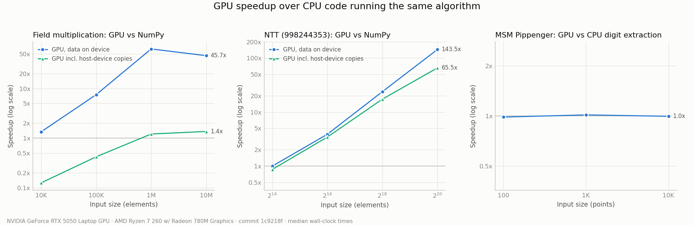
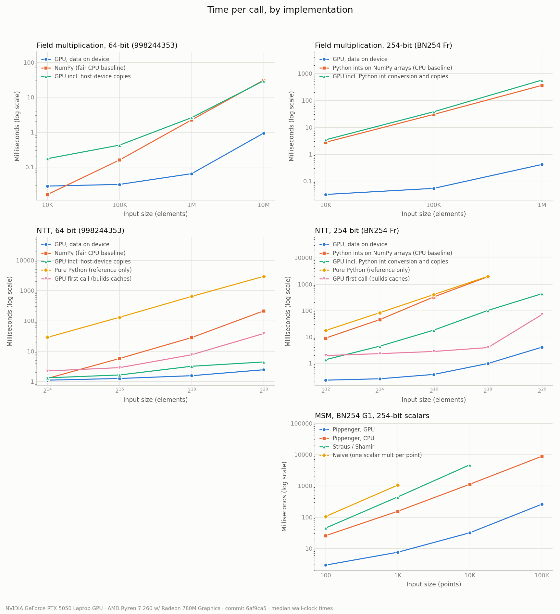
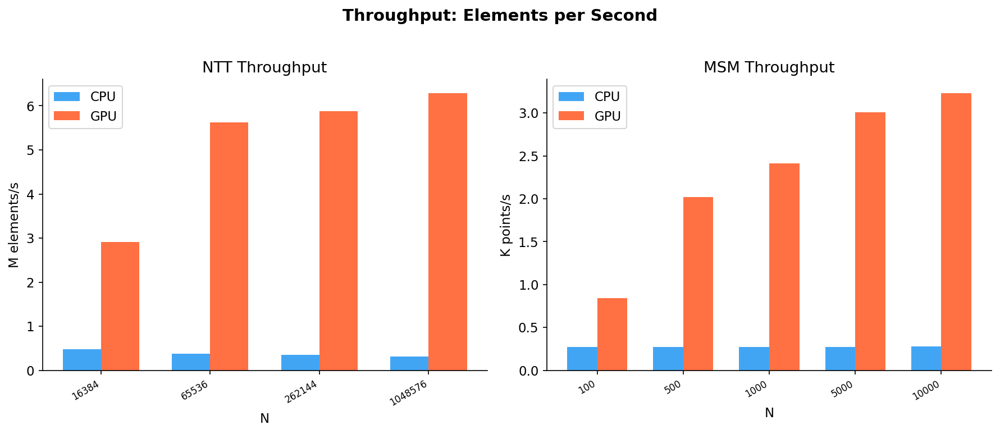

# ZK GPU Accelerator

[](https://github.com/erihhh6/zk-gpu-accelerator/actions/workflows/ci.yml)
[](https://www.python.org/downloads/)
[](LICENSE)


> GPU-accelerated primitives for Zero-Knowledge proof generation (NTT + MSM) using NVIDIA CUDA via CuPy.





---

## What this does

Accelerates the two most expensive operations in ZK proof generation using NVIDIA CUDA, achieving **up to 45x speedup** over pure CPU:

| Operation | ZK Usage | CPU Algorithm | GPU Algorithm | Peak Speedup |
|---|---|---|---|---|
| **NTT** | Polynomial multiplication (PLONK, Groth16) | Cooley-Tukey iterative | Parallel butterfly (CuPy kernel) | **20x** |
| **MSM** | Linear combinations of EC points (Groth16) | Naive (per-point double-and-add) | Pippenger (CPU buckets) + GPU window extraction | **12x** |
| **Field** | Modular arithmetic building block | NumPy vectorized | CuPy ElementwiseKernel | **45x** |

Tested on: **NVIDIA GeForce RTX 5050 Laptop GPU** (Compute Capability 12.0, 8 GB VRAM)

---

## Background

ZK proofs (Groth16, PLONK) spend **80–90% of prover time** in two operations:

- **MSM** (Multi-Scalar Multiplication) — given vectors of EC points P₁…Pₙ and scalars s₁…sₙ, compute Σ sᵢPᵢ. Accounts for ~**65%** of total proving time.
- **NTT** (Number Theoretic Transform) — the FFT over a finite field, used for polynomial multiplication in the constraint system. Accounts for ~**22%** of total proving time.

Both are *embarrassingly parallel* → ideal for GPU acceleration.

**Curve**: BN254 (aka alt_bn128) — the curve used by Ethereum's zkSNARK precompile.
- Base field prime: `p = 21888242871839275222246405745257275088696311157297823662689037894645226208583`
- Scalar field prime: `r = 21888242871839275222246405745257275088548364400416034343698204186575808495617`

---

## Benchmark Results

> Hardware: NVIDIA GeForce RTX 5050 Laptop GPU | CUDA 12.8 | Python 3.13

### Field Arithmetic (modular multiplication, MOD = 998244353)

| N | CPU (ms) | GPU (ms) | Speedup | GPU Throughput |
|---|---|---|---|---|
| 10,000 | 0.04 | 0.02 | 2.1x | 526 M ops/s |
| 100,000 | 0.23 | 0.03 | 8.4x | 3,704 M ops/s |
| 1,000,000 | 3.56 | 0.08 | **45.1x** | 12,658 M ops/s |
| 10,000,000 | 35.27 | 0.84 | **42.1x** | 11,947 M ops/s |

### NTT — Cooley-Tukey (MOD = 998244353)

| N | CPU (ms) | GPU (ms) | Speedup | GPU Throughput |
|---|---|---|---|---|
| 2¹⁴ = 16,384 | 34.1 | 5.6 | 6.1x | 2.91 M elem/s |
| 2¹⁶ = 65,536 | 174.8 | 11.6 | 15.0x | 5.63 M elem/s |
| 2¹⁸ = 262,144 | 733.5 | 44.6 | 16.4x | 5.88 M elem/s |
| 2²⁰ = 1,048,576 | 3,400.9 | 166.8 | **20.4x** | 6.29 M elem/s |

### MSM — BN254 G1 (Pippenger window=8 on GPU)

| N | CPU (ms) | GPU (ms) | Speedup | Mem Transfer |
|---|---|---|---|---|
| 100 | 367.1 | 119.2 | 3.1x | 0.10 ms |
| 500 | 1,862.0 | 247.1 | 7.5x | 0.10 ms |
| 1,000 | 3,652.3 | 414.2 | 8.8x | 0.11 ms |
| 5,000 | 18,256.2 | 1,662.4 | 11.0x | 0.11 ms |
| 10,000 | 36,139.6 | 3,093.4 | **11.7x** | 0.17 ms |

---

## Installation

### Prerequisites

- Python 3.11+
- NVIDIA GPU with CUDA support
- PyTorch (provides `nvrtc64_*.dll` on Windows, needed for CuPy kernel compilation)

Check your CUDA version:
```bash
nvidia-smi
```
Look for `CUDA Version: XX.Y` in the top-right of the output.

### Install

```bash
git clone https://github.com/erihhh6/zk-gpu-accelerator.git
cd zk-gpu-accelerator
pip install -r requirements.txt
```

> **Important**: `requirements.txt` defaults to `cupy-cuda12x` (CUDA 12.x).
> If you have CUDA 11.x, replace it with `cupy-cuda11x`.
> If you have no GPU, comment out the `cupy-cuda12x` line — all GPU functions fall back to CPU automatically.

### Windows — make CuPy find nvrtc

On Windows, CuPy needs `nvrtc64_*.dll` to compile GPU kernels. If you have PyTorch installed, it already bundles this DLL. Add the PyTorch lib directory to your PATH once:

```powershell
# Find your Python site-packages path (adjust if needed)
$torch_lib = "C:\Users\YOUR_NAME\AppData\Local\Programs\Python\Python313\Lib\site-packages\torch\lib"
[System.Environment]::SetEnvironmentVariable("PATH", "$torch_lib;$env:PATH", "User")
```

If you don't have PyTorch, install the full [CUDA Toolkit](https://developer.nvidia.com/cuda-downloads) which includes nvrtc.

### Verify the GPU setup

```bash
python scripts/check_gpu.py
```

This checks the NVIDIA driver, the CuPy import, CUDA device visibility and kernel compilation (nvrtc), and prints the first layer that fails. It exits with code 1 if the GPU paths are disabled. When any layer fails, the GPU functions still run on the CPU but emit a `GpuFallbackWarning` with the reason. If GPU tests are being skipped, `pytest -rs` lists why.

> **Windows 11:** Smart App Control can refuse to load CuPy's compiled `.pyd` files ("An Application Control policy has blocked this file"), sometimes only intermittently. The script detects this and shows how to confirm it in the Code Integrity event log.

---

## Usage

### Field Arithmetic

```python
from src.field import Fp, batch_mul, FIELD_MODULUS

a = Fp(12345)
b = Fp(67890)
print(a * b)       # Fp multiplication mod r
print(a.inv())     # Fermat's little theorem inverse
print(a ** 254)    # fast exponentiation

# Batch operations on int lists
result = batch_mul([1, 2, 3], [4, 5, 6], FIELD_MODULUS)
```

### GPU Field Arithmetic

```python
import cupy as cp
from src.field_gpu import gpu_batch_mul, gpu_batch_add, gpu_batch_pow

MOD = 998_244_353
a = cp.array([3, 5, 7], dtype=cp.int64)
b = cp.array([4, 6, 8], dtype=cp.int64)

print(gpu_batch_mul(a, b, MOD))   # [12, 30, 56]
print(gpu_batch_add(a, b, MOD))   # [7, 11, 15]
print(gpu_batch_pow(a, 3, MOD))   # [27, 125, 343]
```

### BN254 Curve Operations

```python
from src.curve import G, Point

P = G * 42
Q = G * 7
R = P + Q
print(R.is_on_curve())   # True
```

### NTT (CPU)

```python
from src.ntt import ntt, polynomial_mul, MOD

a = [1, 2, 3, 4, 5, 6, 7, 8]
A = ntt(a, MOD)
assert ntt(A, MOD, invert=True) == a   # perfect round-trip

# Polynomial multiplication O(N log N)
print(polynomial_mul([1, 1], [1, 1], MOD))   # [1, 2, 1] = 1 + 2x + x²
```

### NTT (GPU)

```python
import cupy as cp
from src.ntt_gpu import ntt_gpu
from src.ntt import MOD

a = cp.array([1, 2, 3, 4, 5, 6, 7, 8], dtype=cp.int64)
A = ntt_gpu(a, MOD)
recovered = ntt_gpu(A, MOD, invert=True)
print(recovered.tolist())   # [1, 2, 3, 4, 5, 6, 7, 8]
```

### MSM (CPU)

```python
from src.curve import G
from src.msm import msm_naive, msm_double_and_add

points = [G * i for i in range(1, 11)]
scalars = list(range(1, 11))

result = msm_naive(points, scalars)
result2 = msm_double_and_add(points, scalars)
assert result == result2
```

### MSM (GPU — Pippenger)

```python
import numpy as np
from src.msm_gpu import msm_pippenger_gpu
from src.curve import G, P as CURVE_P

points = [G * i for i in range(1, 1001)]
scalars = list(range(1, 1001))

px = np.array([p.x for p in points], dtype=object)
py = np.array([p.y for p in points], dtype=object)
sc = np.array(scalars, dtype=np.int64)

x, y = msm_pippenger_gpu(px, py, sc, CURVE_P, window_size=8)
```

### Run benchmarks

```bash
# All benchmarks + summary table
python benchmarks/run_all.py

# Generate PNG charts from results
python benchmarks/plot_results.py

# Groth16 prover timing simulation
python demo/prover_simulation.py
```

### Run tests

```bash
pytest tests/ -v -rxs
```

- Tests marked `gpu` skip automatically when no usable GPU is found, and the skip message names the reason.
- Tests reported as `xfail` are **known bugs**: each one asserts the *correct* behaviour and is expected to fail until the bug is fixed. They are strict, so the commit that fixes a bug must also remove its `known_bug` marker (see `tests/known_bugs.py`).
- `-rxs` prints the reason for every skip and xfail.

---

## Project Structure

```
zk-gpu-accelerator/
├── src/
│   ├── gpu_backend.py # One-time CUDA/CuPy detection + reason when unavailable
│   ├── field.py       # Fp arithmetic CPU — BN254 scalar field
│   ├── field_gpu.py   # Fp arithmetic GPU — CuPy ElementwiseKernel
│   ├── curve.py       # BN254 G1 point operations (affine coordinates)
│   ├── ntt.py         # Cooley-Tukey NTT CPU (MOD = 998244353)
│   ├── ntt_gpu.py     # NTT GPU — parallel butterfly CuPy kernel
│   ├── msm.py         # MSM CPU — naive + Straus/Shamir double-and-add
│   └── msm_gpu.py     # MSM — Pippenger (CPU buckets) + GPU window extraction
├── benchmarks/
│   ├── bench_field.py
│   ├── bench_ntt.py
│   ├── bench_msm.py
│   ├── run_all.py
│   └── plot_results.py
├── tests/
│   ├── known_bugs.py        # Strict-xfail marker for documented, unfixed bugs
│   ├── test_field.py        # Fp arithmetic (CPU)
│   ├── test_field_gpu.py    # GPU field ops vs Python ints, GPU + fallback paths
│   ├── test_curve.py        # BN254 group law, py_ecc known answers
│   ├── test_ntt.py          # NTT across moduli, roots-of-unity known answer, GPU
│   ├── test_msm.py          # naive / Shamir / Pippenger MSM, GPU + fallback paths
│   └── test_gpu_backend.py  # GPU detection reports why it is disabled
├── scripts/
│   └── check_gpu.py   # Layer-by-layer GPU setup diagnostic
├── demo/
│   └── prover_simulation.py
├── results/           # auto-generated JSON + PNG charts
└── requirements.txt
```

---

## Implementation Notes

- **Field**: BN254 scalar field (r ≈ 2²⁵⁴). All Fp ops use Python's built-in `pow()` for fast modular exponentiation. The GPU field ops (`src/field_gpu.py`) accept any modulus `2 ≤ mod < 2⁶³` and any int64 inputs, which they reduce first. Products use a plain int64 multiply up to `mod ≤ 3,037,000,500`, and an exact 128-bit-wide routine above that, built on `__umul64hi` because NVRTC on Windows has no `__int128`. The GPU benchmark uses `MOD = 998244353`.
- **NTT**: Cooley-Tukey iterative with bit-reversal permutation. The default modulus is `998244353 = 119·2²³ + 1` (N ≤ 2²³), but any odd prime works up to its 2-adicity, including BN254's scalar field r (2-adicity 28, N ≤ 2²⁸). Roots of unity come from the field's smallest quadratic non-residue, which yields primitive power-of-two roots without factoring p − 1, and every root is checked to be primitive. The GPU version (`src/ntt_gpu.py`) handles primes below 2⁶³: it caches its twiddle table and bit-reversal index on the device for each size, and uses `src/field_gpu.py` for exact modular arithmetic. BN254's r does not fit in int64, so it is CPU-only for now.
- **MSM**: Naive and Straus/Shamir simultaneous double-and-add on CPU (one shared accumulator: ~254 doublings in total instead of N·254, about 3× faster than naive for 254-bit scalars); Pippenger bucket method with only the scalar window extraction on the GPU (bucket accumulation stays on the CPU). All BN254 point arithmetic uses Python's arbitrary-precision integers (254-bit coordinates).
- **GPU kernels**: Written with CuPy's `ElementwiseKernel` (CUDA C++ compiled at runtime via nvrtc). Works without the full CUDA Toolkit — only nvrtc is needed (bundled with PyTorch on Windows).
- **Fallback**: GPU availability is decided once, at import, in `src/gpu_backend.py`. When it is unavailable, every GPU function falls back to NumPy/CPU and emits a `GpuFallbackWarning` naming the reason, so no code changes are needed on CPU-only machines.
- **Benchmarking**: Median of 3 runs; first GPU run discarded (CuPy JIT warmup).

---

## References

- Groth16: <https://eprint.iacr.org/2016/260.pdf>
- Pippenger MSM: <https://cr.yp.to/papers/pippenger.pdf>
- BN254 curve parameters: <https://neuromancer.sk/std/bn/bn254>
- NTT primer: <https://cp-algorithms.com/algebra/fft.html>
- CuPy documentation: <https://docs.cupy.dev>
